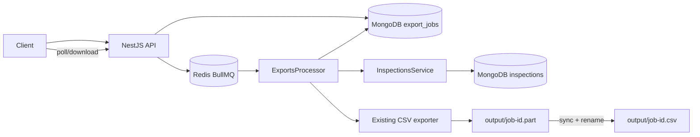

# Loopr Customer-Configurable Data Export

A small multi-tenant export platform built in stages. The working workflow accepts a customer-specific CSV configuration, queues a job, reads tenant-scoped inspection records in bounded batches, writes a locally recoverable CSV, and exposes job progress and download APIs. It demonstrates the export core; it is not a production-ready commercial service or a complete implementation of every destination scenario.

See [docs/DESIGN.md](docs/DESIGN.md) for architecture, recovery behavior, S3/ERP/scheduling proposals and version migration. See [docs/SUBMISSION.md](docs/SUBMISSION.md) for the implementation summary and [docs/ACCEPTANCE.md](docs/ACCEPTANCE.md) for requirement-by-requirement status.

## Implemented features

- NestJS REST API, MongoDB inspection/job persistence, and Redis/BullMQ background work.
- Customer field selection and PASS/FAIL filter, with tenant and workspace isolation in every inspection query.
- CSV escaping, missing-value handling, and spreadsheet formula-injection protection from the original standalone exporter.
- Keyset pagination, fixed export upper bound, batch progress, byte-offset checkpoint, retry recovery and atomic local-file publication.
- Immutable configuration revision registry, per-job snapshots, and separate output schema version metadata.
- Sample data for two tenants, multiple workspaces/sessions, two Stage 1 customer configs, unit tests and a real MongoDB worker restart test.

Image uploads to S3, scheduled exports and ERP API integration are design-only proposals. There is no frontend, authentication, or Stage 5 destination implementation.

## Architecture



The API validates and snapshots configuration, creates a `QUEUED` job and enqueues its MongoDB ID. The worker marks it `PROCESSING`, captures an upper-bound ID, reads bounded sorted batches, writes and syncs CSV, then commits a checkpoint. After final sync and atomic rename, the job becomes `COMPLETED`. MongoDB is the source of truth for status; Redis coordinates work and retries.

## Stack and prerequisites

- Node.js 20 or newer and npm
- Docker with Compose
- MongoDB 7 and Redis 7 (provided by Compose)

## Local setup

From the repository root:

```sh
npm install
cp .env.example .env
docker compose up -d
npm run seed
npm run start
```

Set `EXPORT_BATCH_SIZE=3` in `.env` to make several batches visible in the sample. The default is 1,000. Run a single application/worker process: the local partial-file protocol assumes one writer. The API and worker use the same local `output/` directory.

`.env.example` defines `MONGODB_URI`, `REDIS_HOST`, `REDIS_PORT`, `PORT`, and `EXPORT_BATCH_SIZE`. Do not commit `.env` or secrets. Run `npm run seed` again safely; it upserts sample inspections by ID.

## API

Create a CSV export. Legacy requests default to configuration ID `inspection-report`, revision 1, and output schema version 1.

```sh
curl -sS -X POST http://localhost:3000/exports \
  -H 'Content-Type: application/json' \
  -d '{"tenantId":"tenant-a","workspaceId":"assembly","configId":"inspection-report","version":1,"type":"csv","outputSchemaVersion":1,"fields":["id","result","timestamp"],"filters":{"result":"FAIL"}}'
```

The API returns HTTP 202 with a job ID. Poll progress and download after completion:

```sh
JOB_ID=replace-with-returned-id
curl -sS "http://localhost:3000/exports/$JOB_ID"
curl -fS "http://localhost:3000/exports/$JOB_ID/download" -o export.csv
```

The job response includes config revision/schema version, status, progress, processed/total records, attempt count and checkpoint metadata. Download is unavailable until `COMPLETED`. The Stage 1 standalone JSON CLI remains available with `npm run export -- config/customer-a.json` or `config/customer-b.json`.

## Recovery demonstration and tests

```sh
npm test
TEST_MONGODB_URI=mongodb://127.0.0.1:27017/looprai_recovery_test npm test
```

The first command builds the project, runs Jest unit tests, then the preserved Node test suite. The MongoDB-dependent process-restart test is skipped when `TEST_MONGODB_URI` is unset. The second command runs it against a real MongoDB database: a child worker syncs its first batch and is killed before checkpointing, then a restarted worker truncates the uncommitted bytes and completes the CSV. Test data is removed afterward.

In-process test hooks also simulate interruption before write, after write/before checkpoint, after checkpoint, and after final rename. These hooks are not accepted in the HTTP DTO. In-memory simulations test the failure points; only the child-process test models actual process termination.

## Versioning and compatibility

A configuration revision identifies customer settings; an output schema version identifies the CSV contract. The first resolved definition for `(tenantId, configId, version)` is stored in an immutable registry; reusing a version with different settings returns 409. Each export also stores its own resolved snapshot, so a newer revision does not change an in-progress job. Version 1 CSV is the only implemented schema. Safe customer migration steps and a sample v1-to-v2 header change are described in the design document. Existing delivered files are never rewritten automatically.

## Limits and security

- Caller-supplied tenant IDs are not authentication. Production must derive tenant identity from an authenticated context and authorize status/download access for every job.
- String IDs use simple binary lexicographic ordering. Correct upper-bound behavior assumes append-only records, immutable unique IDs, and monotonic insertion visibility per tenant/workspace. An ID upper bound is not database snapshot isolation.
- Processing is at least once. Checkpoints and truncation aim to prevent duplicate output rows after retries under a single-writer, durable-local-filesystem assumption; they do not guarantee exactly-once execution or distributed durability.
- MongoDB and Redis do not share a transaction. A crash between job creation and enqueue can leave a queued job without queue state; there is no outbox/reconciliation.
- No scheduling, S3, ERP, large-dataset snapshot transactions, distributed fencing, tenant fairness/quotas, or production observability are implemented.

Future connector flows and operational recommendations are proposals, not working features. Read [docs/DESIGN.md](docs/DESIGN.md) for details.
