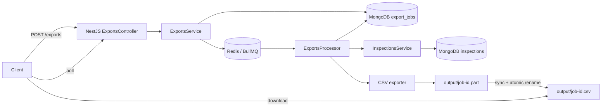

# Loopr Export Platform — Design

This document distinguishes **Implemented** behavior in this repository, **Simulated** behavior exercised by test hooks, and **Proposed** designs for destinations and schedules that are not built.

## 1. Problem and requirements

The platform lets multiple customers export inspection data using customer-specific selection and field rules. It must isolate tenant data, process large reports with bounded memory, recover interrupted CSV jobs, and leave room for image delivery and ERP events. The implemented end-to-end workflow is asynchronous CSV export to local disk. S3 image delivery, scheduled reports, and ERP delivery are proposed designs only.

## 2. Assumptions

- Inspection IDs are unique immutable strings. Queries use MongoDB simple binary collation, making ordering bytewise lexicographic (`a-10` sorts before `a-2`).
- For a given tenant/workspace, IDs are allocated monotonically and become visible in that order. Inspections are append-only during an export.
- One application worker process writes a given output directory. The partial/final directory is on one local filesystem that supports atomic same-filesystem rename and durable sync operations.
- Configuration and tenant IDs in the request are caller-supplied. They are not authenticated identity.
- The export worker uses fixed validated fields and filters; arbitrary code or MongoDB query fragments are never accepted.

## 3. Architecture

**Implemented:** API, MongoDB job/inspection models, Redis BullMQ queue, worker, framework-independent CSV logic, and local files.



## 4. Components and responsibilities

- **Export configuration:** **Implemented** as a validated request snapshot (`configId`, `version`, `type`, `outputSchemaVersion`, tenant/workspace, allowed fields, optional result filter). Destination is currently local CSV only; credentials are not accepted in the request.
- **Data reader:** **Implemented** in `InspectionsService`, querying tenant + workspace + optional result with keyset cursor and upper bound.
- **Transformer:** **Implemented** by the existing CSV field selection and cell serialization functions. It preserves requested field order, escaping, empty optional cells, and formula-injection protection.
- **Destination adapter:** **Proposed** logical boundary for local file, object storage, or HTTP delivery. The current path writes CSV directly to Node.js filesystem; no plugin framework is added.
- **Export orchestrator:** **Implemented** across `ExportsService`, MongoDB job state, BullMQ and `ExportsProcessor`: enqueue, attempt, progress, checkpoint, retry and completion.

A connector requires core code when it introduces a new protocol, authentication mechanism, rate/error behavior, consistency guarantee or data source. A customer request can use configuration when it only changes allowed field mapping, filtering, timestamp formatting or a supported destination setting. Customer configuration must remain declarative and validated.

Illustrative future boundary (**Proposed**, not current implementation):

```ts
interface DestinationAdapter<Batch, Result> {
  write(batch: Batch, idempotencyKey: string): Promise<Result>;
  finalize(): Promise<void>;
}
```

## 5. Data and configuration models

**Implemented inspection document:** `id`, `tenantId`, `workspaceId`, `sessionId`, `timestamp`, `result`, `confidence`, optional `imageUrl`. Compound indexes support `{tenantId, workspaceId, id}` and `{tenantId, workspaceId, result, id}` with simple collation.

**Implemented export job:** tenant/workspace, immutable config snapshot, config ID/revision and output schema version, status (`QUEUED`, `PROCESSING`, `COMPLETED`, `FAILED`), progress/counts, attempt count, keyset cursor and upper bound, batch size, committed output byte offset, checkpoint version, timestamps, finalization metadata, path and safe error.

Legacy requests without a `configId` or `version` resolve to `inspection-report` revision 1. CSV `type` and output schema version default to `csv` and 1. Only output schema version 1 is implemented. A small `export_config_versions` collection stores the first resolved definition under a unique `(tenantId, configId, version)` key. Its config and fingerprint are immutable. Reusing a key with different fields, filters, workspace or output schema returns 409; customers submit a new revision. Every job also stores a copied immutable snapshot, so processing does not look up mutable configuration. The output schema version describes the consumer-facing CSV contract; the configuration revision identifies customer settings. They are separate fields because settings can change without changing CSV shape, and vice versa.

**Proposed config extension:** versioned declarative mappings can name output headers and source fields, select transformations from an allowlist, and refer to a secure destination credential ID. Never store secret values in the config or export job.

## 6. CSV lifecycle

1. The API validates the request and resolves defaults into an immutable snapshot.
2. It creates a `QUEUED` MongoDB job and submits the job ID to BullMQ. A queue error sets a safe failure status and returns 503.
3. A worker claims the job, captures the largest matching ID as `upperBoundId`, counts eligible rows, and persists its batch size/config snapshot.
4. It creates the CSV header once, syncs it, and records the byte offset.
5. It reads a bounded batch, maps and serializes the batch, writes it with backpressure/short-write handling, syncs the file, and commits the last ID/count/byte offset in MongoDB.
6. It repeats until the cursor reaches the upper bound. Progress reflects committed selected rows.
7. It hashes the completed partial file, records finalization metadata, renames the partial file atomically, syncs the containing directory, then marks the job complete.

The header and each batch are held only as small strings/buffers. The whole data set and full CSV are never accumulated. API downloads use a filesystem read stream.

## 7. Failure and recovery

**Implemented recovery protocol:** MongoDB checkpoints and filesystem writes cannot be one transaction. The worker stores `outputOffsetBytes` only after syncing a complete batch. At the next attempt it compares the `.part` file size to this offset. An oversized partial is truncated and synced; an equal-sized partial resumes after `lastProcessedId`; a missing or shorter partial with committed bytes fails as unrecoverable. The header has its own checkpoint. Each write uses a positional handle and waits for all bytes before updating the checkpoint.

A SHA-256 digest plus final byte length and `finalizing` marker detect a crash after rename but before MongoDB completion. A retry verifies the final file and completes the job without regenerating it. It refuses a mismatched file. Directory sync is attempted after rename; some platforms do not support syncing directories, in which case publication fails visibly.

**Simulated in tests:** hooks interrupt before a batch, after file sync but before checkpoint, after checkpoint, and after rename. A separate child worker is also killed after a synced but uncheckpointed batch, then restarted against real MongoDB. The test verifies the truncated/replayed bytes yield one correct output row per inspection.

This is at-least-once processing, not exactly-once execution. A record/batch can be read and computed again after a crash. The offset protocol aims for one copy in a successfully published file under the append-only, stable-ID and single-writer assumptions. It does not provide distributed filesystem durability or fencing from a stale worker after BullMQ lock loss.

## 8. Keyset pagination and scale

**Implemented:** `id > lastProcessedId AND id <= upperBoundId`, sorted ascending with simple collation and a limit. No `skip` pagination and no full matching-record array. `EXPORT_BATCH_SIZE` defaults to 1000 and is validated from 1 to 100000. The worker concurrency is one. Indexes support cursor scans with and without the result equality filter.

The implementation counts records at the beginning for progress. The count can be expensive on very large datasets; an alternative is indeterminate progress or periodic estimated progress. Batch memory is O(batch size × record size), plus the current serialized CSV batch, rather than O(total dataset).

## 9. Consistency boundary

The maximum matching ID is captured before processing. Under the stated monotonic-visibility assumption, new higher IDs are excluded. If data can be modified, deleted, backfilled with lower IDs, or committed out of order, the ID bound is not a database snapshot. The current code does not use snapshot transactions, change streams, or a materialized export manifest.

## 10. Image to S3 design — Proposed

Customer A wants failures at `s3://customer-quality-exports/inspections/{sessionId}/{imageId}.jpg`.

1. A validated config selects failed inspections, allowed workspace/session filters, key template and a missing-image policy (`fail-job`, `skip-and-report`, or `record-partial-failure`). Validate bucket allowlists and normalized object keys; reject traversal-like segments and unexpected prefixes.
2. A tenant-scoped reader pages records. A source resolver selects historical or current image storage adapters from a versioned image reference; it does not trust arbitrary URLs from a record.
3. Stream image bytes from the source to the customer bucket to bound memory. Record each image's source ID, destination key, byte count, checksum and outcome.
4. Retry transient timeouts, throttling and server errors with bounded exponential backoff. Permanent not-found and authorization errors follow the explicit missing/failure policy. Expose completed, skipped, rejected and retrying counts plus per-record safe error codes.
5. Use a restricted cross-account IAM role and short-lived role credentials, least-privilege `PutObject` access to an approved prefix, and encryption policies. Do not store permanent AWS keys. Never log credentials, signed URLs or sensitive image metadata. Enforce tenant scope before resolving either source or destination.
6. Deterministic object keys plus content length/checksum make a repeated upload idempotent when the object is unchanged. Verify the destination checksum/metadata where supported. If content can change under the same key, retries may overwrite a newer object; use immutable versioned keys, object versioning, or conditional writes and retain the content hash.

No S3 SDK, AWS identity, image source adapter, upload tracking collection or bucket policy is implemented here.

## 11. Scheduled hourly CSV — Proposed

Customer B wants hourly failed-inspection CSV with selected fields and a custom timestamp format. Store schedule, IANA timezone, revision, destination reference, late-arrival grace period and a clear interval rule in a versioned schedule config. Resolve calendar boundaries in that timezone, then persist the interval as UTC `[start, end)` instants to avoid daylight-saving ambiguity. A BullMQ repeatable schedule or external scheduler creates the same export job used by the current API; the worker remains the execution path.

Use a unique idempotency key such as `(tenant, scheduleId, scheduleRevision, intervalStartUTC, intervalEndUTC)` to prevent duplicate job creation. Reject or coalesce overlapping intervals per customer schedule. Retry missed scheduler ticks by enumerating intervals through the current time. Define a watermark/grace period for late records; either delay finalization until the interval closes or publish corrections as a separately versioned report. Deliver to a supported customer destination after generation. Scheduling, deduplication, timezone calculations, and report delivery are not implemented.

## 12. ERP inspection events — Proposed

Customer C maps a failed inspection to an ERP quality endpoint, for example:

```json
{
  "componentId": "CMP-1001",
  "qualityStatus": "REJECTED",
  "defectCode": "SURFACE_CRACK",
  "inspectionTime": "2026-11-20T10:30:00Z"
}
```

A validated mapping config transforms source fields to allowed ERP properties. Store credentials in a secret manager and reference them by ID; use short-lived OAuth/client credentials where possible. Set connect and total timeouts. Honor `429` and `Retry-After`, then use bounded exponential backoff with jitter. Retry network errors and selected `5xx`; classify most `4xx` as permanent configuration/data rejection, with explicit handling for token refresh and endpoint-specific conflict responses. Apply per-tenant/per-endpoint concurrency and rate limits.

Persist per-record delivery attempts, safe response class, idempotency key and audit correlation ID. Partial successes remain successful; permanent rejects go to a review/dead-letter workflow, and operators can manually reprocess selected records. If ERP supports idempotency keys, derive a stable key from tenant + inspection ID + config revision. Without destination cooperation, a timeout after the ERP commits but before the client receives a response makes exactly-once delivery impossible. Track queue age, latency, retries, status distribution, 429/5xx rate and dead-letter count without logging credentials or sensitive payloads. No ERP connector is implemented.

## 13. Configuration versioning and compatibility

Configuration revision is the customer-selected settings release; output schema version is the external contract of the CSV. The small registry pins the first definition for `(tenantId, configId, version)`, and a unique index prevents concurrent alternate definitions. Each job pins that revision and stores the resolved snapshot. Reusing the same revision with different settings returns 409. A newer revision can be introduced by submitting a new version number; an existing job continues with its stored fields, filters and versions. The registry has no UI, approval workflow or publishing lifecycle.

**Safe six-month CSV change:** keep v1 available; create v2 with output names `inspection_id,quality_status,inspected_at` mapped to existing source values and a declared status/time conversion. Validate every mapping against the allowed source field list and output contract. Run v2 in a test workspace or a shadow export; compare row counts, null rates, and representative records with v1. Have the customer validate headers, types, ordering, timezone and downstream parser behavior. Gradually make v2 the selected revision for new jobs while retaining v1 for existing integrations. Each job records its chosen config revision and output schema version, so in-progress and historical job metadata do not change.

Previously delivered files are immutable historical artifacts; they are not rewritten. If the customer needs historical v2 files, create a separate explicitly requested backfill with a different versioned destination/prefix, then compare counts and samples before enabling it downstream. Roll back new jobs to v1 by selecting the prior revision; do not alter jobs already completed or silently rerun them. Trade-offs: version retention and duplicated output storage cost money, and a config version alone cannot prove consumer compatibility. The minimal immutable version registry exists; approval flow, UI, backfill and automated migration do not.

## 14. Security and tenant isolation

**Implemented:** DTO validation and whitelist rejection; known export fields; result enum validation; typed string tenant/workspace values; fixed Mongo query objects; tenant/workspace predicates on upper-bound, count and batch queries; server-generated ObjectId filenames; local paths derived from validated ID; safe public errors; CSV quoting and formula marker prefixing. Export job config snapshots are immutable through Mongoose.

**Limit:** there is no authentication or authorization. Any caller may supply a tenant ID, read a job by ID or download it. Production must derive tenant from authenticated claims and authorize every job read/download. Add API quotas, maximum date/range/row limits, request size limits, and per-tenant worker concurrency/fair scheduling. Protect Redis and MongoDB network access and credentials. Future destination secrets must live in a secret manager, not Mongo config, environment dumps, logs or queue payloads.

## 15. Scaling and operations

The single process is suitable for learning and local demonstration. At larger scale, separate API and workers while keeping the same shared durable output store; then add a real lease/fencing strategy before allowing concurrent writers. Increase worker replicas only with tenant fairness, concurrency limits, queue-age alerts and shared durable artifacts. The current local file protocol assumes one process and one filesystem.

Suggested metrics: queue depth/oldest age, enqueue failures, processing duration, records/sec, batch latency, retry count, checkpoint lag, bytes written, failures by safe code, finalization errors, per-tenant usage, memory and event-loop delay. Logs should carry job ID, attempt, tenant-safe correlation ID and checkpoint version without credentials or sensitive record content. Alert on growing queue age, repeated failures, missing/short files, checksum mismatch, disk pressure and Mongo/Redis disconnects. Set disk quotas and retention for CSV artifacts and abandoned `.part` files.

## 16. Trade-offs and rejected alternatives

- **Chosen:** string ID keyset scans and a simple upper bound. This works for sample IDs and avoids skip pagination, but depends on enforced allocation assumptions.
- **Chosen:** local partial file + byte offset + sync + atomic rename. Simple to inspect and test; not distributed or cloud durable.
- **Chosen:** single worker concurrency. It reduces writer races; it limits throughput and still is not a fencing token against stale processes.
- **Not chosen:** full snapshot transaction, change stream manifest, transactional outbox, distributed lease, generic destination framework. They add operational complexity outside this learning stage and are future improvements.

## 17. Future improvements

Enforce monotonic sortable IDs at ingestion; add authenticated tenant authorization; add operator review and automated compatibility checks around the minimal version registry; add outbox/reconciliation; evaluate snapshot manifests; use durable shared artifact storage with leases/fencing; add tenant quotas/fair scheduling; then implement S3, schedules and ERP adapters as separately scoped, tested capabilities.
